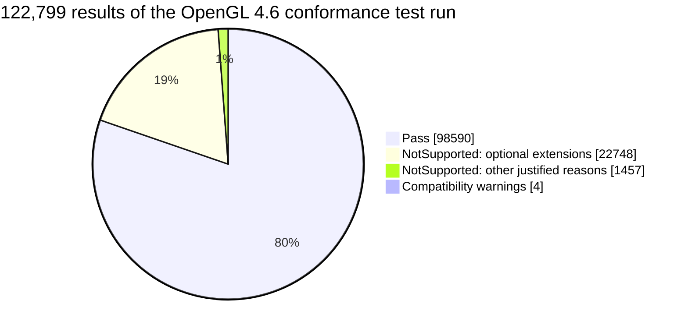

<h1 align="center">PS5 OpenGL</h1>

<p align="center">
  <strong>OpenGL 4.6 Core and GLSL 4.60 for PlayStation 5 homebrew</strong><br>
  A native graphics stack built on Mesa/Gallium: runtime shader compilation,
  fullscreen EGL at 1080p, 1440p or 4K, a relocatable static SDK and an SDL2 bridge.
</p>

<p align="center">
  <a href="https://github.com/blackbearreloaded/ps5-opengl/releases/latest"></a>
  
  
  <a href="docs/gl46-conformance-run.md"></a>
  
  
  <a href="LICENSE"></a>
</p>

[](https://i.imgur.com/4KKg2xn.mp4)

*Click the image to watch the demo. The showcase renders at 4K and 120 Hz on the
console; the capture hardware recorded it at 60 Hz, which is why the screenshot
and video show 60 FPS.*

> [!IMPORTANT]
> PS5 OpenGL is experimental and **not Khronos-certified**. It runs in an already
> configured native homebrew environment; it does not provide console enablement
> or guarantee that desktop applications run unchanged.

## Highlights

- **OpenGL 4.6 Core / GLSL 4.60:** all 657 core commands are exported by the static SDK,
  with Mesa state tracking and runtime shader compilation to native GPU code.
- **Tested with the Khronos suite:** SDK 1.0.0 passes the complete OpenGL 4.6
  conformance test run on a PS5 ([report](docs/gl46-conformance-run.md)).
- **One SDK for every display:** choose 1080p, 1440p or 4K at 60 or 120 Hz at runtime;
  the PS5 scales the picture to whatever the TV accepts.
- **Modern GPU features:** compute shaders, SSBOs, image load/store, indirect and
  indirect-count multi-draw with `gl_DrawID`, direct state access, float render
  targets, 16x anisotropic filtering, timer queries and tessellation/geometry stages.
- **Accelerated paths:** GPU draws with batching, and GPU clears, blits, transfers and
  mip/layer paths where eligible; remaining cases fall back to the CPU.
- **Drop-in integration:** Make, pkg-config and CMake packages, an SDL2 bridge, and
  examples from a minimal triangle to Dear ImGui, NanoVG, Sokol and a 4K showcase.

## Quick start

Download the latest SDK from [Releases](https://github.com/blackbearreloaded/ps5-opengl/releases/latest),
verify it with its `.sha256` file and point your build at its `sdk/` directory
(see [using the SDK](docs/consumer-build.md)). Then create a context as on any EGL platform:

```c
#include <EGL/egl.h>
#include <ps5_opengl_display_modes.h>   /* SDK 0.5.0 and later */

EGLDisplay display = eglGetDisplay(EGL_DEFAULT_DISPLAY);
eglSetDisplayModePS5(display, 3840, 2160);   /* optional: 1080p is the default */
eglSetDisplayRefreshPS5(display, 60);
eglInitialize(display, NULL, NULL);
eglBindAPI(EGL_OPENGL_API);
/* eglChooseConfig, then eglCreateWindowSurface(display, config, 0, NULL)
   and an OpenGL 4.6 Core context, as usual. */
```

Package the result as a native title folder (the
[native app boilerplate](https://github.com/blackbearreloaded/ps5-native-app-boilerplate)
does this) and launch it as a registered title; do not send it to an ELF loader.

## Display modes

| Mode | Size | Refresh | |
| --- | --- | --- | --- |
| 1080p (Full HD) | 1920×1080 | 60 / 120 Hz | Startup default |
| 1440p (QHD, "2K") | 2560×1440 | 60 / 120 Hz | |
| 2160p (4K UHD) | 3840×2160 | 60 / 120 Hz | |

Modes are chosen before EGL starts and changed by restarting EGL; a display without
120 Hz keeps presenting at 60 Hz. See [Display modes](docs/display-modes.md).

## Examples

| Example | Demonstrates |
| --- | --- |
| [OpenGL 4.6 showcase](examples/core46-showcase/README.md) | 4K at 120 FPS: 262k compute particles, GPU culling into `glMultiDrawElementsIndirectCount`, HDR bloom |
| [OpenGL 4.6 compute cubes](examples/core46-compute-cubes/README.md) | A compute shader writes an SSBO; one indirect instanced draw per frame |
| [Triangle](examples/core33-triangle/README.md) | Minimal OpenGL 4.6 context, shaders and draw: the starting point for a new app |
| [Dear ImGui](examples/core33-imgui/README.md) | Unmodified upstream ImGui OpenGL3 backend, with an interactive TV demo |
| [NanoVG](examples/core33-nanovg/README.md) | Unmodified upstream NanoVG GL3 vector renderer |
| [Sokol](examples/core33-sokol/README.md) and [Sokol cube](examples/core33-sokol-cube/README.md) | Unmodified `sokol_gfx` GL backend, and an upstream desktop sample ported to the SDK |
| [Textured cubes benchmark](examples/core33-cubes/README.md) | Ordinary versus instanced draw submission |

The examples are code references built from source; only the showcase ships as
a prebuilt app. The ImGui, NanoVG and Sokol examples use those libraries'
OpenGL 3.3 backends unchanged, which the OpenGL 4.6 SDK runs as-is.

Each SDK release also attaches the showcase as a ready-to-install demo app
(`ps5-opengl-showcase-<version>-PPSA99005.zip`). Each example is packaged as the
native test title `PPSA99005`:

```sh
make source-fetch
make sdk-gl46          # or set PS5_OPENGL_PREFIX to a downloaded SDK's sdk/ directory
make showcase          # imgui-demo, nanovg, sokol, sokol-cube, gl46-demo, ...
```

Deploy `build/native-app/PPSA99005/dist/PPSA99005` to `/data/homebrew/PPSA99005`.

`make demo` builds the demo app on its own: it builds the SDK if needed, fetches the
pinned native-app boilerplate below `build/`, builds the showcase and writes
`build/demo/ps5-opengl-showcase-<DEMO_VERSION>-PPSA99005.zip` with its checksum.
It only builds; it never deploys or runs anything.

## Build from source

`make sdk` builds the shader compiler, Mesa and the installed OpenGL 4.6 SDK into
`build/sdk/ps5-opengl-gl46`, running its compiler tests and capability audit; `make test`
runs the host test suite. The build uses every CPU core and ccache when installed.
See [Building](docs/building.md) for prerequisites and build options.

## Performance

| Workload at 4K | Completed frames/s |
| --- | ---: |
| OpenGL 4.6 showcase, SDK 1.0.0 (4K at 120 Hz) | 119.9 |
| Dear ImGui window, SDK 0.2.0 | 119.88 |
| 128 textured cubes, ordinary draws, SDK 0.2.0 | 58.09 |
| 128 textured cubes, instanced draws, SDK 0.2.0 | 117.41 |

A full native app (ProsperoPuzzles) holds 60 FPS at 1080p, 1440p and 4K on SDK 0.5.0.
These are workload measurements, not general game FPS. See
[performance and methodology](docs/performance.md).

## Validation

SDK 1.0.0 passes the complete **Khronos OpenGL 4.6 conformance test run** on a
PS5: every session of `cts-runner --type=gl46` from VK-GL-CTS 4.6.8.1, in one
launch of one binary, with no failure and no crash.

| Results | Pass | NotSupported | Compatibility warnings | Failures |
| ---: | ---: | ---: | ---: | ---: |
| **122,799** | **98,590** | 24,205 | 4 | **0** |



| Session | Surface | Results | Pass | NotSupported | Warnings | Failures |
| --- | --- | ---: | ---: | ---: | ---: | ---: |
| OpenGL ES 3.0 tests under OpenGL 4.5 | 256x256 | 1,325 | 1,325 | 0 | 0 | 0 |
| OpenGL ES 3.1 tests under OpenGL 4.5 | 256x256 | 31,248 | 30,866 | 382 | 0 | 0 |
| Context creation, OpenGL 3.0 to 4.5 | 64x64 | 22 | 3 | 19 | 0 | 0 |
| OpenGL 4.6, single configuration | 64x64 | 11,348 | 5,056 | 6,292 | 0 | 0 |
| OpenGL 4.6 | 64x64 | 19,714 | 15,335 | 4,378 | 1 | 0 |
| OpenGL 4.6 | 113x47 | 19,714 | 15,335 | 4,378 | 1 | 0 |
| OpenGL 4.6 | Framebuffer object 64x16384 | 19,714 | 15,335 | 4,378 | 1 | 0 |
| OpenGL 4.6 | Framebuffer object 16384x64 | 19,714 | 15,335 | 4,378 | 1 | 0 |
| **Total** | | **122,799** | **98,590** | **24,205** | **4** | **0** |

A compatibility warning is a passing result: one framebuffer completeness case
reports it in each OpenGL 4.6 session.

Every `NotSupported` result is assigned to a rule, and the run is rejected if one
is left over:

| Why a test reports NotSupported | Results |
| --- | ---: |
| It tests an extension outside OpenGL 4.6 (sparse textures and buffers, shader subgroups, fragment shading rate, mesh shaders and others) | 22,748 |
| The test excludes the combination itself (OpenGL ES only, formats or targets it does not apply to) | 871 |
| It needs more than 4 samples or a multisampled default framebuffer | 532 |
| It needs more than the minimum OpenGL 4.6 requires for a limit | 35 |
| It insists on a window surface; the conformant configuration renders offscreen. All of these pass in a supplementary run | 19 |

The [report](docs/gl46-conformance-run.md) describes the run and what it fixed;
the [evidence](validation/2026-10-01-gl46-conformance/README.md) holds every
case result, the runner summary and the justifications, and `make test` verifies
it. The earlier OpenGL 3.3 campaign accounts for 39,544 results: 37,404 pass and
2,140 reviewed `NotSupported` ([report](docs/validation.md)).

The results were not submitted to Khronos: this is the project's own run of the
test suite, not Khronos certification. They belong to the tested binary, the
test application built from the 1.0.0 source, and to one console. SDK 1.0.1 is
1.0.0 plus one vertex-buffer fix; it was checked with a focused run of 3,317 of
those cases, not a new complete run. SDK 1.0.2 adds the changes listed in the
[details](docs/gl46-conformance-run.md#later-releases) and was not run through
the suite again. See [supported boundaries](docs/limitations.md).

## Releases

| SDK | Highlights |
| --- | --- |
| [1.0.2](https://github.com/blackbearreloaded/ps5-opengl/releases/tag/v1.0.2) | Program queries no longer end an application that links only the SDK ([#9](https://github.com/blackbearreloaded/ps5-opengl/issues/9)); draw statistics are printed at teardown only, unless asked for; a submission may take 30 seconds to retire ([#10](https://github.com/blackbearreloaded/ps5-opengl/issues/10)); legacy varyings; one scanout flush instead of one per unbatched draw |
| [1.0.1](https://github.com/blackbearreloaded/ps5-opengl/releases/tag/v1.0.1) | Fixes an abort or use-after-free when vertex buffers are re-sent while the driver holds their last reference ([#3](https://github.com/blackbearreloaded/ps5-opengl/issues/3)) |
| [1.0.0](https://github.com/blackbearreloaded/ps5-opengl/releases/tag/v1.0.0) | Passes the complete Khronos OpenGL 4.6 conformance test run ([report](docs/gl46-conformance-run.md)); robust-access and no-error contexts |
| [0.6.0](https://github.com/blackbearreloaded/ps5-opengl/releases/tag/v0.6.0) | Queued compute: about 15-35 us of CPU per dispatch instead of 1.1 ms; showcase demo app |
| [0.5.0](https://github.com/blackbearreloaded/ps5-opengl/releases/tag/v0.5.0) | One SDK for every display: 1080p/1440p/4K at 60/120 Hz chosen at runtime |
| [0.4.1](https://github.com/blackbearreloaded/ps5-opengl/releases/tag/v0.4.1) | Presentation, native preparation and descriptor publication fixes |
| [0.3.0](https://github.com/blackbearreloaded/ps5-opengl/releases/tag/v0.3.0) | First OpenGL 4.6 release ([scope](docs/release-0.3.0.md)) |
| [0.2.0](docs/release-g62.md) | Historical OpenGL 3.3 release |

## Documentation

- [Documentation index](docs/README.md)
- [Using the SDK](docs/consumer-build.md), [display modes](docs/display-modes.md) and [SDL2 integration](integration/SDL2/README.md)
- [Building](docs/building.md), [testing](docs/testing.md) and [CI releases](docs/ci-releases.md)
- [Architecture](docs/architecture.md), [lifecycle](docs/lifecycle-reopen.md) and [limitations](docs/limitations.md)
- [Performance](docs/performance.md) and [validation](docs/validation.md)
- [Contributing](CONTRIBUTING.md) and [third-party notices](THIRD_PARTY_NOTICES.md)

<!-- bbr-footer:start -->
<!-- Generated by ps5-homebrew-dev-protocol/scripts/readme-footer. Edit the template there, not here. -->

## Credits

Built with the [PS5 Payload SDK](https://github.com/ps5-payload-dev/sdk) by John Törnblom (ps5-payload-dev).
Third-party components, authors and licenses are listed in
[THIRD_PARTY_NOTICES.md](THIRD_PARTY_NOTICES.md).

## License

Copyright © 2026 BlackBearReloaded. Licensed under GPL-3.0-or-later; see [LICENSE](LICENSE). Third-party components keep their own licenses. Binary releases are built from the tagged source in this repository.

## Disclaimer

- **No affiliation.** This is an independent homebrew project. It is not
  affiliated with, endorsed by, or sponsored by Sony Interactive Entertainment.
  "PlayStation", "PS5" and related marks are trademarks of Sony Interactive
  Entertainment Inc. OpenGL is a registered trademark of Hewlett Packard Enterprise, used by permission by Khronos. This project is not affiliated with or endorsed by The Khronos Group.
- **No proprietary material.** No Sony SDK, firmware, encryption keys or
  decrypted system modules are included.
- **No warranty.** This project is provided "as is", without warranty of any
  kind, to the extent permitted by law. See sections 15 and 16 of the GPL.
- **Use at your own risk.** Running homebrew requires a modified console, which
  may void its warranty, breach the platform's terms of service, or cause data
  loss.
- **Legal use only.** Use it only with hardware, accounts and content you own.
  This project does not support or enable piracy.

## AI assistance

This project was developed with AI assistance from OpenAI and/or Anthropic tools.
<!-- bbr-footer:end -->
